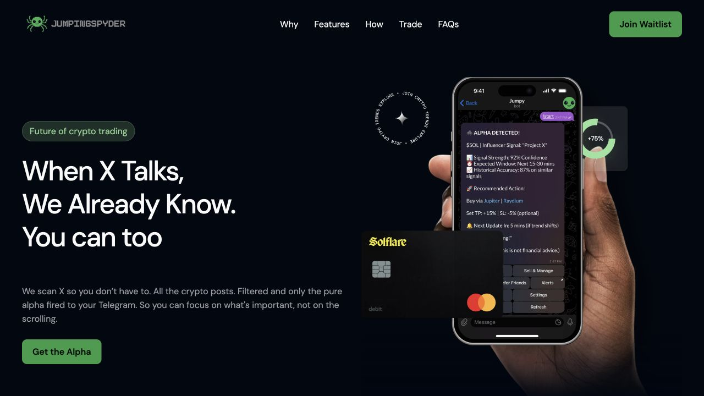

<p align="center"></p>

<h1 align="center">JumpingSpyder</h1>
<p align="center"><strong>When X Talks, We Already Know.</strong><br>Social monitoring, filtered Telegram alerts, and the original JumpingSpyder landing page.</p>
<p align="center">
  <a href="https://github.com/stefisha/JumpingSpyder/actions/workflows/checks.yml"></a>
  
  
  <a href="LICENSE"></a>
</p>
<p align="center"><a href="#landing-page">Landing page</a> · <a href="#try-it-in-two-minutes">Run the worker demo</a> · <a href="docs/architecture.md">Architecture</a> · <a href="docs/evaluation.md">Measured baseline</a> · <a href="docs/running.md">Run & configure</a> · <a href="docs/history.md">Project history</a></p>

JumpingSpyder pairs a public-facing landing page with a server-side social-monitoring service. The original alpha used n8n and a backend on Google Cloud to fetch tweets from a predefined account list, filter relevant posts, and send alerts to one shared Telegram chat.

As co-founder, I was responsible for the application’s architecture, frontend, backend, deployment and maintenance. The project is now discontinued.

This repository contains the rebuilt landing page and one maintained Python worker with persisted classifications and Telegram retries. The recovered Node.js bot, Python prototype, and n8n workflow remain in [`archive/`](archive/). Individual bot messages and subscriber preferences remain future work.

## Landing page

The [rebuilt website](web/landing/README.md) recreates the original Framer design with local artwork, DM Sans, responsive layouts, the hero entrance, phone tilt, partner ticker, and animated FAQs. Join Waitlist opens the original Google Form; Get the Alpha links to Jumpy on Telegram.

<p align="center"></p>

Preview the website locally from the repository root:

```sh
python3 -m http.server 8766 --bind 127.0.0.1 --directory web/landing
```

Open [localhost:8766](http://127.0.0.1:8766/). The static website can be hosted separately from the worker. Its historical marketing artwork does not establish measured trading results or implemented trading controls.

## Service

The maintained worker collects posts from configured X accounts and upload metadata from YouTube, classifies the author's expressed market stance, and attaches a source excerpt to every result. It stores processing and delivery state in SQLite and retries failed Telegram sends. A separate local review report helps inspect classifications; it is an internal tool, not the public landing page.

**Status:** offline application and mocked live-adapter contracts are tested. Live provider behavior has not been verified with real credentials or redeployed to GCP in this rebuild. There is no trading execution or payment collection in the maintained worker.

## Try it in two minutes

Requires **Python 3.9+ on macOS or Linux**. No API keys, database server, or frontend build are needed.

```sh
git clone https://github.com/stefisha/JumpingSpyder.git
cd JumpingSpyder
python3 -m venv .venv
source .venv/bin/activate
python -m pip install --upgrade pip
python -m pip install -e .
jumping-spyder demo
```

Open **`reports/demo/index.html`** in your browser. It is a self-contained snapshot with search, stance filters, full-source inspection, and delivery state; there is no running web server or external asset request.

The demo supplies **nine records representing eight unique synthetic posts**. Four directional, unflagged items are reviewed locally; four neutral, conflicting, or flagged items are suppressed from alerts. Run it again to see deduplication: **zero new records and zero repeat deliveries**. “Delivered” in demo CLI output refers to the local review destination; no messages leave your machine.

See the worker’s separate [review-desk screenshot](docs/assets/review-desktop.png) for its source inspection and delivery controls.

## What the engineering demonstrates

| Concern                             | Implementation                                                                                                          |
| ----------------------------------- | ----------------------------------------------------------------------------------------------------------------------- |
| Missed posts between polling runs   | Collect every returned item across pages within an explicit time window; refuse silently truncated page-limited batches |
| Duplicate classification and alerts | Source-qualified primary keys, cached validated classifications, and per-destination delivery records                   |
| Failed Telegram delivery            | Keep the item pending; retry from SQLite after restart without calling the classifier again                             |
| Model output reliability            | Strict JSON Schema request, local enum/type validation, exact-excerpt validation, refusal/truncation handling           |
| Inspectability                      | Source URLs, complete source text, classifier identity, processing errors, and delivery attempt counts                  |
| Reproducibility                     | Credential-free fixtures, labeled challenge cases, regression tests, CI, and an installed-wheel smoke test              |

Delivery is **at least once**, not exactly once: if Telegram accepts a message but the worker crashes before recording the acknowledgment, a retry can duplicate that message. Every alert includes a stable source reference. See [failure handling](docs/architecture.md#failure-handling).

## Classifiers and measured results

- **`rules`** is the default offline keyword baseline. It is deterministic and inspectable, but fails on paraphrases, quoted language, and some ambiguity.
- **`openai`** is an optional model adapter with a configurable model and validated structured output. It has not been evaluated live in this rebuild.

On the included **24 author-labeled synthetic challenge cases**, `rules-v1` scored **62.5% stance accuracy** and **0.665 macro F1**. The mistakes are retained in the [full results](docs/results/baseline.json). These cases demonstrate implementation behavior, not generalization to real social content or market outcomes.

```sh
jumping-spyder evaluate
```

See [evaluation methodology, confusion matrix, and known errors](docs/evaluation.md). The worker does not generate confidence percentages, return targets, or “historical accuracy” fields; the landing page preserves the original concept artwork.

## Import your own source records

```sh
jumping-spyder ingest --input examples/posts.json
jumping-spyder retry
jumping-spyder report
```

The default inbox is `data/jumpy.sqlite3`; the default report is `reports/review.html`. These commands use the local review destination. Adding `--notify` selects Telegram and requires its credentials. Changing classifier flags does not overwrite cached classifications; use a new database to compare classifiers.

For live X/YouTube collection, OpenAI configuration, retry behavior, and scheduling, use the [running guide](docs/running.md). The [configuration reference](docs/configuration.md) documents the JSON input contract and all environment variables.

## Project structure

```text
src/jumping_spyder/    Maintained package and CLI
  domain.py           Validated source and classification contracts
  sources.py          Fixture, X timeline, and YouTube metadata collectors
  classifiers.py      Rules baseline and optional OpenAI adapter
  store.py            SQLite inbox, classifications, and delivery records
  pipeline.py         Failure isolation and retry processing
  sinks.py            Local review and Telegram destinations
  report.py           Escaped, self-contained HTML generation
  data/               Packaged synthetic demo and evaluation cases
  templates/          Self-contained review interface
examples/             Input examples
web/landing/          Static public-facing landing page and local assets
tests/               Regression and adapter-contract tests
docs/                Architecture, configuration, evaluation, screenshots
archive/             Historical implementations; not installed or maintained
.github/workflows/    Automated checks and package verification
```

## Development

```sh
python -m pip install -r requirements-dev.txt
python -m pip install -e . --no-build-isolation
make check
```

`make check` runs Ruff and the offline regression suite. `make package` builds a wheel and verifies the installed CLI, packaged demo data, and report template from outside the checkout. See [CONTRIBUTING.md](CONTRIBUTING.md) and [verification scope](docs/verification.md).

## License

[MIT](LICENSE). Original Jumpy / Jumping Spyder project, 2025; maintained portfolio application, 2026. The supplied project banner retains the original green pixel-spider identity.
