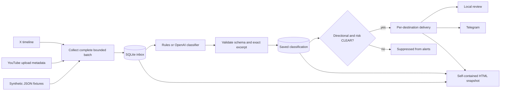

# Architecture

The maintained application is a synchronous Python package with no third-party runtime dependencies. It targets macOS and Linux. SQLite replaces the original worker's PostgreSQL requirement for a portable, inspectable local pilot.

## Contracts

A post has a source-qualified ID, author, HTTPS source URL, timezone-aware publication time, and bounded source text. The composite key is `source:id`. YouTube content is the title plus description, not a transcript. HTML output escapes every provider/model string; JavaScript search only operates on text already in the document.

A classification has four fields: `label`, `risk`, `summary`, and `evidence`. The label is BULLISH, BEARISH, NEUTRAL, or UNCERTAIN; the risk flag is CLEAR, FLAGGED, or UNKNOWN. Evidence must occur verbatim in the stored source. This validates an excerpt's presence, not whether it logically supports the classification. Prompt instructions treat source text as untrusted data, but there is no guarantee that an LLM resists every prompt injection.

A directional classification can alert only when risk is CLEAR. Suppressed content stays available in the report. CLEAR means the classifier found no configured risk indicator; it does not authenticate an account or establish safety. Neither classifier uses historical account behavior, market prices, or return data.

## Persistence and identity

`posts` holds the immutable source snapshot, cached classification, classifier identity, classification attempt count, and the latest generic processing error. `deliveries` holds a separate state and attempt count for each post/destination. Preview and Telegram identities are separate. A Telegram identity hashes bot ID and chat ID so credentials are not stored in the ledger.

The first stored snapshot is authoritative. Re-ingesting the same source ID with different content rejects that complete source batch rather than silently replacing evidence attached to an existing classification. Source edits need explicit reconciliation or a new database; automatic content versioning is future work. A failure in one source does not stop processing already queued records or other sources.

Classifications are reused across destinations and CLI runs. Selecting a new model does not silently reclassify old rows. For a controlled classifier comparison, run the same input against separate fresh databases. `user_version=1` identifies the current schema; unsupported schema versions fail closed. The original PostgreSQL dump is not migrated or distributed.

## Failure handling

1. Fetch and validate a bounded source batch; atomically persist it before any classification or delivery. Collection failure leaves that source's existing inbox unchanged.
2. Process up to `--limit` items, prioritizing the least attempted entries and then publication time. A repeatedly failing item cannot starve the rest of a bounded batch. Individual classification failures remain pending and do not block other items.
3. Commit a valid classification before attempting delivery.
4. Persist pending state, send the message, and mark delivered only after Telegram acknowledges a message ID.
5. Failed sends remain pending. The next `retry --notify` reuses the saved classification.

GET requests retry transient errors with bounded backoff. POST requests are attempted once per processing run. Their result can be ambiguous after a connection failure, so there is no immediate blind replay. Telegram delivery is **at least once**: a crash between remote acceptance and local acknowledgment can lead to a duplicate on the next run. It is not an exactly-once distributed transaction.

The database path is resolved before opening it and deriving its advisory lock, so file symlink aliases share the same lock. That lock prevents two cooperating CLI processes from using the same database at once, and is automatically released on process exit. The database should live on a local filesystem; do not use a shared network drive, multiple independent database copies for the same destination, or a worker that bypasses the lock. External callers of `process_pending` must hold `Store.lock()` themselves.

## Collection boundary

`sync` defaults to a rolling seven-day window. X uses the API's `start_time`; YouTube traverses the channel's uploads playlist until it reaches an older upload. Both follow pagination. If `--pages` is exhausted while more in-window items remain, the source fails instead of committing a partial batch. Increase the cap or narrow `--since` and rerun. A rolling window does not recover an outage longer than the window: provide an older explicit `--since` to catch up. Provider timeline limits, deletions, private posts, and access restrictions still apply.

## Deliberate scope

There is no always-on web server, multi-user authentication, subscription manager, Solana payment handling, order execution, transcript downloader, or market-data backtest. The report is an inspectable static snapshot. Live providers require their own credentials, account access, quotas, and separate end-to-end verification.

## Landing page and Telegram interface

The original product paired a Framer landing page with n8n orchestration and a backend on Google Cloud. The website introduced the project and directed visitors to the bot. Alpha alerts were delivered to one Telegram chat; individual bot messages were the intended next stage.

The rebuilt static page is in `web/landing/`. It links to the original bot and preserves the historical marketing copy and illustrations; it does not register subscribers, call the worker, collect payments, or expose live results. It can run on a different host from the worker. Individual delivery needs subscriber records and per-recipient delivery state; the maintained worker currently targets one configured chat.
